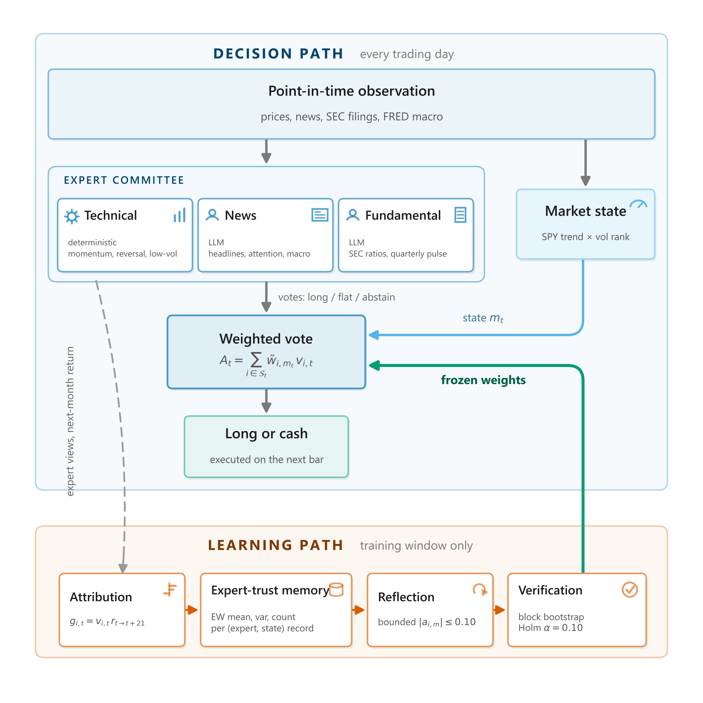
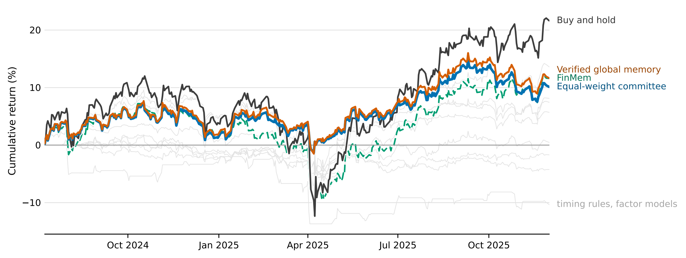
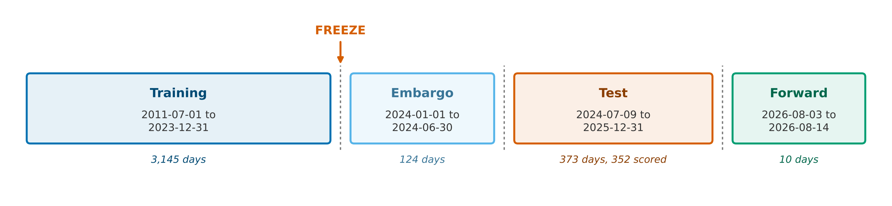
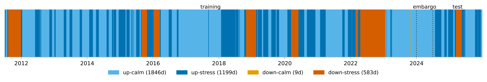

# Can a Trading Agent Learn When to Trust Its Experts?

**Expert-trust memory and statistical verification**

<p align="center">
  <a href="https://github.com/Shanmin123/expert-trust-memory/actions/workflows/tests.yml"></a>
  
  <a href="LICENSE"></a>
  
  
</p>

Code for the MSc dissertation

> **Can a Trading Agent Learn When to Trust Its Experts? Expert-Trust Memory and Statistical Verification**<br>
> Shanmin Sun (University of Edinburgh)<br>
> MSc dissertation, School of Informatics, University of Edinburgh, 2026

<p align="center">
  
</p>
<p align="center"><em>
Figure 1: The decision path runs every trading day. The learning path runs only inside the training
window and reaches the decision path through one step, the verification test.
</em></p>

## Overview

When a language-model trading agent divides its decision among several expert views, it has to decide
how much each one should be trusted. This repository holds a three-expert trading committee that
learns that trust from its own track record, and the statistical test that decides where the learned
trust is allowed to act. Each run trades one stock, long or in cash, and never opens a short
position. The repository contains the full pipeline behind the dissertation:

- **A. Committee.** Each trading day three experts vote long, flat or abstain on the same stock. The
  technical expert is deterministic (momentum, reversal and low-volatility signals against the
  stock's own history, plus a close-based indicator block). The news and fundamental experts call
  `gpt-4.1-mini` at temperature zero: the news expert reads headlines, attention and novelty against
  the stock's own news history and a FRED macro block, and the fundamental expert reads point-in-time
  SEC ratios, the latest quarterly report, two filing-text signals and valuation and risk fields.
  Votes are weighted and renormalised over the experts who spoke. The committee goes long when the
  weighted score is above zero, to cash when it is below zero, and keeps its position at exactly zero.
- **B. Expert-trust memory.** Each (expert, market state) pair is a record, and the memory also keeps
  one global record per expert. A record holds an exponentially weighted mean and variance of the
  expert's contribution (its signed view times the next 21-day return), a hit count, and a bounded
  adjustment from reflection. A fixed formula turns the records into weights, with a standardised
  mean-variance score, a softmax at temperature 0.5 and a floor of 0.05 on every weight. Reflection
  proposes adjustments of at most 0.10, once every 21 episodes. The market state is labelled from SPY
  alone (trend against a 200-day average, crossed with a 21-day realised-volatility rank over 504
  days) as up-calm, up-stress, down-calm or down-stress, and the experts never see it.
- **C. Verification.** At the end of training, every record with at least twenty episodes is tested
  once: a moving-block bootstrap with 42-day blocks on the expert's contribution relative to its peers,
  with Holm's correction at &alpha; = .10 within each stock. Learned weighting is active only where at
  least one record passes. On a stock where nothing passes, the memory makes exactly the decisions of
  the equal-weight committee.
- **D. Evaluation.** The memory is frozen at the end of 2023 and scored once, on 352 trading days
  (July 2024 to December 2025) of twenty randomly drawn US stocks. The confirmatory comparison is the
  verified global memory against the equal-weight committee. Ten outside strategies, ablations of
  verification and of the attribution horizon, market-state conditioning and a text-form trader follow.
- **E. Forward run.** The frozen memory then ran for ten sessions on live data through an Interactive
  Brokers paper account.

**Main findings.**

- Eight of the twenty stocks carry a verified record. The other twelve fall back to equal weights and
  reproduce their equal-weight committees exactly.
- Verified trust changes few decisions and gains on most of the ones it changes: six stocks traded
  differently from their committees, five of them gaining and one losing.
- On the twenty-stock portfolio the verified global memory reaches a Sharpe ratio of +0.855 against
  +0.770 for the equal-weight committee (one-sided bootstrap tail proportion .086), and the mean daily
  difference stays positive when any one stock is dropped.
- Against outside strategies the memory leads on Sharpe and Sortino (+0.855 and +1.276). Buy and hold
  is level with it on Sharpe (+0.852) and earns 21.63% against 11.65%, at a maximum drawdown of 21.75%
  against 8.52%.
- The learned weights work through abstention. When one expert stays silent and the other two
  disagree, the side carrying more weight wins. Replayed on six stocks with every expert forced to
  vote, the learned memories changed nothing.
- Verification narrows the spread of what the memory does and hardly changes its average. The standard
  deviation of the effect on Sharpe falls from 0.386 to 0.065, and the tail proportion against the
  committee is .086 with verification and .462 without it.

## Results

All rows are an equal-capital portfolio over the twenty stocks on the same 352 scored sessions, and
every row pays the same commission.

| Strategy | Sharpe | Sortino | Ann. return (%) | Cum. return (%) | Ann. volatility (%) | Max drawdown (%) |
|---|---:|---:|---:|---:|---:|---:|
| *Timing rules* | | | | | | |
| Turn of the month | -0.827 | -0.981 | -7.51 | -10.33 | 8.95 | 14.48 |
| WMA crossover | -0.451 | -0.617 | -3.05 | -4.24 | 6.43 | 7.51 |
| SMA crossover | -0.174 | -0.248 | -1.22 | -1.70 | 6.00 | 5.83 |
| Trend following | +0.084 | +0.121 | +0.34 | +0.48 | 6.86 | 7.00 |
| Bollinger bands | +0.436 | +0.721 | +4.05 | +5.70 | 10.28 | 11.49 |
| ATR band | +0.611 | +0.987 | +5.75 | +8.13 | 9.96 | 10.89 |
| *Factor models* | | | | | | |
| Alpha158, ridge | +0.509 | +0.719 | +5.27 | +7.44 | 11.37 | 15.78 |
| Alpha158, boosted trees | +0.805 | +1.228 | +9.56 | +13.61 | 12.28 | 15.70 |
| *LLM agent* | | | | | | |
| FinMem | +0.689 | +0.996 | +8.17 | +11.60 | 12.55 | 15.97 |
| *Passive* | | | | | | |
| Buy and hold | +0.852 | +1.260 | +15.05 | +21.63 | 18.43 | 21.75 |
| *This work* | | | | | | |
| Equal-weight committee | +0.770 | +1.142 | +7.15 | +10.12 | 9.55 | 8.06 |
| Verified state memory | +0.769 | +1.138 | +7.16 | +10.14 | 9.58 | 8.09 |
| Verified global memory | **+0.855** | **+1.276** | +8.21 | +11.65 | 9.78 | 8.52 |

<p align="center">
  
</p>
<p align="center"><em>
Figure 2: Cumulative return over the test window: the committee, the verified global memory and buy
and hold, with FinMem dashed and the timing rules and factor models as thin grey lines.
</em></p>

The memory changed decisions on six stocks. Against their equal-weight committees:

| Stock | Sharpe | Cum. return (pp) | Ann. volatility (pp) | Max drawdown (pp) |
|---|---:|---:|---:|---:|
| BIIB | +0.284 | +14.45 | +3.10 | +5.52 |
| ECL | +0.264 | +7.75 | +0.21 | 0.00 |
| AZO | +0.224 | +8.93 | +0.17 | 0.00 |
| DDS | +0.084 | +4.19 | +0.19 | 0.00 |
| CTAS | +0.029 | +1.01 | +0.13 | 0.00 |
| AES | -0.132 | -2.46 | -1.45 | 0.00 |

A positive change in volatility or drawdown means more risk taken.

On the other fourteen the memory and the committee took the same decision on every scored day. For
twelve of them nothing passed verification. A thirteenth, ADSK, has its one verified record in the
state memory, and INCY passed a record whose reweighting never moved a decision across the boundary.

## The frozen memory

The memory that the forward run deployed is in [`frozen_memory/`](frozen_memory), one JSON snapshot per
stock and memory scope. Retrieved at temperature 0.5 with this repository's own code, the snapshots
give the weights that the dissertation fixed before the live run began:

| Stock | Memory | Verified records | Fundamental | News | Technical |
|---|---|---:|---:|---:|---:|
| BIIB | global | 3 | 0.415 | 0.346 | 0.239 |
| ECL | global | 2 | 0.566 | 0.228 | 0.206 |
| AZO | global | 2 | 0.573 | 0.341 | 0.087 |
| CTAS | global | 3 | 0.635 | 0.105 | 0.260 |
| DDS | global | 1 | 0.369 | 0.262 | 0.369 |
| INCY | global | 1 | 0.371 | 0.258 | 0.371 |
| AES | global | 1 | 0.385 | 0.229 | 0.385 |
| ADSK | state | 1 | 0.333 | 0.333 | 0.333 |
| ADSK, in down-stress | state | 1 | 0.456 | 0.456 | 0.088 |
| The other twelve | global | 0 | 0.333 | 0.333 | 0.333 |

`python scripts/show_deployed_weights.py` prints the same weights for all twenty stocks. A snapshot
stores its verified records under the key `certified_cells` and carries a SHA-256 hash of its content,
which `tests/test_frozen_memory.py` recomputes. [`frozen_memory/README.md`](frozen_memory/README.md)
describes the format.

## Repository structure

```
expert-trust-memory/
├── assets/                          # figures used in this README, rendered from the dissertation
├── frozen_memory/                   # the memory snapshots that the forward run deployed
├── experiment_protocols/
│   └── main_walk_forward.json       # reserved test windows and invariants the holdout launcher enforces
├── src/
│   ├── trading_agent/               # the system
│   │   ├── cli.py                   #   three-mode launcher: backtest, holdout, paper
│   │   ├── runner.py                #   the daily decision loop
│   │   ├── contracts.py             #   Signal, ExpertView, the Expert protocol
│   │   ├── expert_context.py        #   builds each expert's context from the data adapters
│   │   ├── experts/                 #   technical, news and fundamental experts and their backends
│   │   ├── alpha/                   #   market-state classifier, price signals, text signals
│   │   ├── aggregation/             #   floored-simplex weights and the weighted vote
│   │   ├── memory/                  #   scorecard, reflection, attribution, verification test
│   │   ├── execution/               #   adapter onto the FINSABER backtest engine
│   │   ├── data/                    #   point-in-time data access
│   │   └── experiments/             #   train, freeze and test drivers
│   └── data_collection/             # SEC XBRL, FRED and Interactive Brokers collectors
├── scripts/                         # experiment drivers, baselines, figure builders (scripts/README.md)
├── tests/                           # pytest suite
└── docs/
    ├── code_map.md                  # file-by-file map of the package
    └── live_trading.md              # running against an Interactive Brokers paper account
```

## Installation

Python 3.10, the version the results were produced and the tests run on.

```bash
git clone https://github.com/Shanmin123/expert-trust-memory.git
cd expert-trust-memory
python -m venv .venv && source .venv/bin/activate        # Windows: .venv\Scripts\activate

# FINSABER supplies the data loaders and the backtest engine. This is the commit
# that the results were produced with.
git clone https://github.com/waylonli/FINSABER.git external/FINSABER
git -C external/FINSABER checkout d7d2dcb477b92b4f580201b93b4e973e2736c530

pip install -e ".[dev]"
```

The package finds FINSABER under `external/FINSABER` in the working directory or a parent, or at the path
in `FINSABER_SOURCE_ROOT`. Three extras cover the rest: `research` for the baselines and the figure
builders, `paper` for the Interactive Brokers connection, and `llm` for recording new expert views.
Replaying the recorded views needs neither `llm` nor an API key. The OpenAI client is imported lazily,
and in replay mode a missing view raises an error instead of reaching the model, so a replay cannot
quietly become a model call.

## Quick start

These two commands need no data.

```bash
python -m pytest                          # the unit tests
python scripts/show_deployed_weights.py   # the weights each frozen snapshot deploys
```

```text
Frozen snapshots in frozen_memory, retrieval at tau=0.5

  BIIB  global global       fund=0.415  news=0.346  tech=0.239   3 verified, departs from equal
  ECL   global global       fund=0.566  news=0.228  tech=0.206   2 verified, departs from equal
  AZO   global global       fund=0.573  news=0.341  tech=0.087   2 verified, departs from equal
  CTAS  global global       fund=0.635  news=0.105  tech=0.260   3 verified, departs from equal
  ...
```

## Running the system

The launcher has three modes. From a source checkout without installing, `python -m trading_agent` and
`python scripts/trading_agent_cli.py` expose the same modes as the installed `trading-agent` command.
`python -m trading_agent --help` lists every flag.

**backtest** runs the system over one historical window.

```bash
python -m trading_agent backtest --data-root <FINSABER_PARQUET_ROOT> \
    --start 2020-01-01 --end 2021-01-01 --output reports/trading_agent_backtest.json
```

**holdout** trains the memory through `--validation-boundary`, freezes it, validates it read-only
through `--boundary`, and evaluates three settings (equal weight, global memory, market-state memory)
through `--end`.

```bash
python -m trading_agent holdout --data-root <FINSABER_PARQUET_ROOT> \
    --start 2020-01-01 --validation-boundary 2021-07-01 --boundary 2022-01-01 --end 2023-01-01 \
    --output reports/expert_weight_holdout --memory-output reports/expert_weight_memory.json
```

The JSON report carries `memory_snapshot`, `split_protocol`, `validation_arms`,
`reflection_trial_audit`, `expert_error_by_state` and `system_completion`. The tuned grid is the
retrieval temperature, `--temperature-grid 0.5,1,2`. The decision threshold is fixed at zero, so the
committee goes long on a weighted majority. The selected temperature is frozen before the test window
and the grid size is counted in `trial_count`. Reflection runs with `--reflect-every 21`,
`--reflection-window 63` and `--reflection-min-support 5`. Signal history is preloaded for
`--preload-calendar-days 900` before the run starts, so trailing windows are full at the first
decision. Results are net of the commission schedule the FINSABER benchmark charges, $0.0049 a share,
at least $0.99 an order and at most one percent of the trade.

**paper** connects to IB Gateway.

```bash
python -m trading_agent paper --host 127.0.0.1 --port 4002 --client-id 1 --connection-smoke
python -m trading_agent paper --symbols AAPL,MSFT --auto-decide --paper-cash 10000 \
    --memory-snapshot reports/expert_weight_holdout.json --dry-run
```

`--auto-decide` builds a point-in-time observation from the latest IB bars, labels the market state,
calls the three experts, applies the weights from `--memory-snapshot`, and scales the deployed cash by
the aggregation score. `--order SYMBOL:buy|sell:QTY` previews a named order instead. `--dry-run` never
submits and `--execute-orders` submits, and the two cannot be combined. `--require-memory` fails
instead of falling back to equal weights, `--use-account-cash` reads IB `AvailableFunds`, and
`--max-order-value` caps each preview by notional. Execution is restricted to the paper ports 4002 and
7497 unless `--allow-non-paper-port` is given. [`docs/live_trading.md`](docs/live_trading.md) covers the
live path in full, including the three ways a live run can go quietly wrong.

## Data

The large inputs are not in this repository. Point `TRADING_AGENT_DATA_ROOT` at the tree that holds
them (it defaults to `data/` in the checkout), and run `python -m trading_agent.paths` to see what
resolves and what does not.

```bash
export TRADING_AGENT_DATA_ROOT=/path/to/trading-agent-data      # Windows: set TRADING_AGENT_DATA_ROOT=...
```

| Input | Where it comes from | Location under the data root |
|---|---|---|
| Daily prices, news items, 10-K and 10-Q text | the FINSABER parquet panel, S&P 500 2000 to 2025, delisted names included | `finsaber/sp500_2000_2025_parquet` |
| Structured company financials | SEC EDGAR XBRL `companyfacts` API, collected by `scripts/collect_sec_xbrl.py` | `sec_xbrl/financials.parquet` |
| Macro block | FRED: `DFF`, `T10Y2Y`, `CPIAUCSL`, `ICSA`, `UNRATE`, collected by `scripts/collect_fred_macro.py` | `macro/fred_macro.parquet` |
| Market proxy for the market-state label | SPY dividend-adjusted daily close, `scripts/download_market_proxy.py` | `market_proxy/spy_daily.parquet` |
| Expert views | recorded once by this project and replayed | `corpus/` |

The panel, the recorded views and the live-run account records are not redistributed. The panel and its
news text come from FINSABER and its data providers, and the recorded views are model responses over
that text. What is released is the frozen memory, the figures and the code.

Each adapter serves only what was public at the decision date.

| Input | Rule |
|---|---|
| Financials | selected on the XBRL `filed` date, not the period end |
| Filings | readable from their public date; the accessor returns the latest at `t` and the previous one of the same form |
| `DFF`, `T10Y2Y` | 0-day release lag |
| `ICSA` | 7-day release lag |
| `CPIAUCSL`, `UNRATE` | 45-day release lag |
| Prices | read up to the decision date; fills execute on the next bar |

The FRED series are latest-revision, not ALFRED vintages, so the lag fixes availability but not
revision. Universe selection rejects a current-membership snapshot and marks the run
survivorship-limited.

## Reproducing the dissertation

Only recording the expert views calls a model. Every later step replays the recorded views, so the
reported numbers are reproducible offline and at no cost once the inputs above are in place. Without
them these scripts stop on the first missing path.

| Step | Command | Dissertation | What it does |
|---|---|---|---|
| 1 | `scripts/collect_sec_xbrl.py`, `collect_fred_macro.py`, `download_market_proxy.py` | Data and market state | Point-in-time financials, macro block and SPY proxy |
| 2 | `scripts/select_random_universe.py` | Data and market state | The reproducible twenty-stock draw |
| 3 | `python -m trading_agent holdout --view-corpus-mode readthrough` | System implementation | Record each stock's expert views once (needs the `llm` extra and an API key) |
| 4 | `python -m trading_agent holdout --view-corpus-mode replay` | Main result | Train, freeze, verify and score one stock, replaying the recorded views |
| 5 | `scripts/portfolio20.py`, `portfolio_arm_metrics.py`, `rescore_finsaber_cost.py`, `reprice_next_open.py` | Main result | Score all twenty stocks on one calendar and charge the commission schedule |
| 6 | `scripts/cross_name_significance.py`, `portfolio_block_sensitivity.py`, `per_stock_metrics.py`, `verified_records_table.py` | Main result, appendix | Significance tests, block-length sensitivity, per-stock metrics, the table of every verified record |
| 7 | `scripts/baseline_arms.py`, `baseline_table.py`, `alpha_mining_baseline.py`, `finmem_baseline.py`, `tradingagents_baseline.py`, `buy_and_hold_nextopen.py` | External baselines | Rule-based timing, factor models, FinMem, TradingAgents and buy and hold, scored like the memory |
| 8 | `scripts/ungated_twenty.py`, `ungated_verdict.py`, `horizon_sweep20.py` | Ablations | Verification off, and other attribution horizons |
| 9 | `scripts/trust_persistence.py` | Sources of the small effect | Whether measured trust persists from one period to the next |
| 10 | `scripts/produce_llm_skills.py`, `run_trader_arms.py`, `score_primaries20.py`, `llm_decision_paired_analysis.py` | Findings in text form | Verified findings written as sentences for a text-based trader |
| 11 | `scripts/live_analysis.py`, `paper_forward_run.py`, `forward_run_accounting.py` | Forward demonstration | The committee read, the order previews and the run's accounting |
| 12 | `scripts/architecture_figures.py`, `dissertation_figures.py`, `equity_curve_figure.py` | Figures | The diagrams and result figures |

[`scripts/README.md`](scripts/README.md) lists every script by purpose.

## Protocol

| Window | Dates | Days |
|---|---|---:|
| Training | 2011-07-01 to 2023-12-31 | 3,145 |
| Embargo | 2024-01-01 to 2024-06-30 | 124 |
| Test | 2024-07-09 to 2025-12-31 | 373, of which 352 scored |
| Forward run | 2026-08-03 to 2026-08-14 | 10 |

<p align="center">
  
</p>

The memory is frozen at the end of training and verification runs once, at the freeze. The learning
path does not run again. The last twenty-one test days carry no forward return, so 352 days are
scored. A decision is filled at the open of the next bar and valued at the close, and the system is
fully invested or fully in cash, so sizing is identical across settings. Learning evidence is the
experts' own views scored at unit size, so it does not depend on the weights or on the system's
actions.

The twenty stocks are one random draw (seed 42) from the 436 S&P 500 names with price coverage on
90% of sessions and 900 dated news days across 2011 to 2025, after excluding AMZN, MSFT, NFLX and
TSLA.

<p align="center">
  
</p>
<p align="center"><em>
Figure 3: The market-state label over the whole sample. Down-calm is nearly empty (9 days), so the
label has three usable states in practice.
</em></p>

## Forward run

The frozen memory ran on live data for ten sessions, 3 to 14 August 2026, through an Interactive
Brokers paper account. Each order was capped at $5,000, so the twenty positions together could not
exceed $100,000. The order layer reads the committee's recorded decision and submits only the position
change the account needs, so a stock already at its target produces no order.

- All 200 weight retrievals (twenty stocks over ten sessions) matched the table above to three decimals.
- 70 of the 200 stock-days carried weights other than equal. On 10 of those the weights could decide,
  because more than one expert spoke and they disagreed, and on 8 the learned call differed from the
  equal-weight call.
- 18 of the 20 stocks traded, with 29 orders. The book cost $82,921 to build and returned +0.01% over
  the ten sessions.

The run checks that the frozen memory loads and retrieves the weights fixed in advance, and that the
resulting decision reaches an executable order. Ten sessions are too few to measure performance.

The live run traded through [ibkr-live-trading](https://github.com/Shanmin123/ibkr-live-trading),
which connects to IB Gateway and supplies market data, news, account state and order placement. Orders
are previewed until `--execute` is passed, and submission is refused unless the account matches the
configured paper-account prefix, `DU` by default.

## Scope and limits

- The twenty stocks are survivors: a name needed price and news coverage across 2011 to 2025, and none
  of the twenty was delisted in those years.
- The test window is a rising one. SPY returned +24.3% over the scored sessions and no bear year falls
  inside the window. About six of the memory's 8.21% a year comes from a beta of 0.34 against SPY.
- The evidence on any single stock is modest. No stock reaches the deflated-Sharpe convention of 0.95,
  and the highest is 0.830. At the observed effect and variance, about forty-six stocks would be needed
  to resolve the difference between the learned weights and equal weights.
- The experts' hit rates sit close to even. The memory reweights the views the experts give it and
  cannot supply a view they do not.

## Citation

```bibtex
@mastersthesis{sun2026expert,
  title  = {Can a Trading Agent Learn When to Trust Its Experts? Expert-Trust Memory and Statistical Verification},
  author = {Shanmin Sun},
  school = {School of Informatics, University of Edinburgh},
  type   = {MSc dissertation},
  year   = {2026}
}
```

## Acknowledgements

I thank my supervisor, Professor Tiejun Ma, for guidance on the direction of the project, and Waylon
Li, the author of FINSABER, for his help and advice throughout. The evaluation is built on his
benchmark, and the timing-rule baselines are his implementations at their default parameters, run
through his engine.

## License

The code is released under the [MIT License](LICENSE). The data sources keep their own terms.
